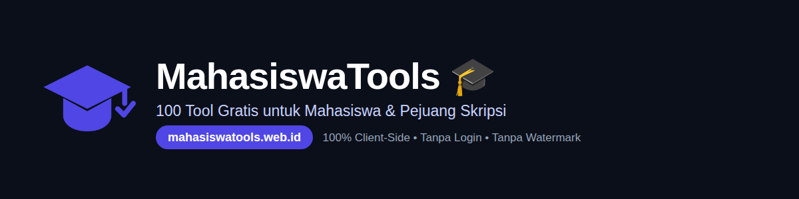
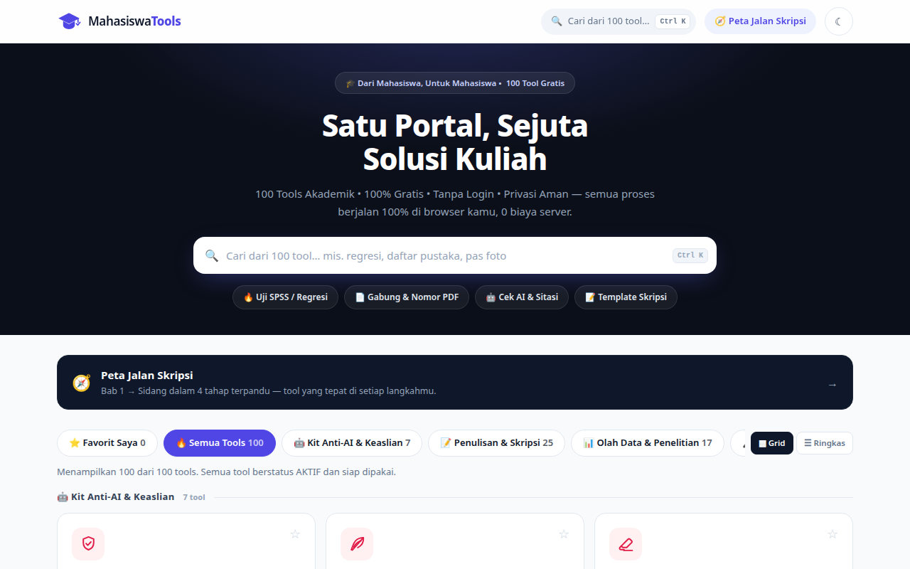
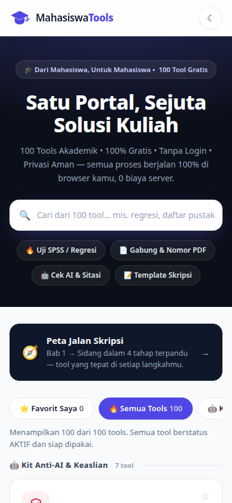
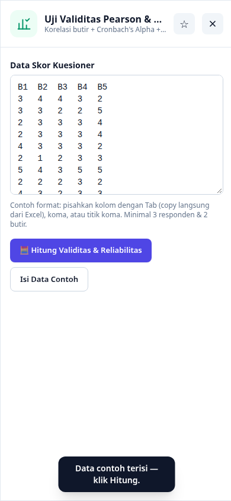

<p align="center">
  
</p>

<p align="center">
  <a href="https://mahasiswatools.web.id"></a>
  
  
  <a href="LICENSE"></a>
</p>

<p align="center"><b>Dari Mahasiswa, Untuk Mahasiswa.</b> Satu portal berisi 118 alat bantu kuliah & skripsi — gratis, tanpa login, tanpa watermark, dan berjalan 100% di browser. Tidak ada data yang dikirim ke server mana pun.</p>

<p align="center">
  <a href="https://mahasiswatools.web.id"><b>🌐 Buka Situsnya</b></a> •
  <a href="#-direktori-100-tool">📚 Direktori Tool</a> •
  <a href="#-teknologi--arsitektur">🛠️ Teknologi</a> •
  <a href="#-menjalankan-di-lokal">💻 Jalankan Lokal</a>
</p>

---

## ✨ Kenapa MahasiswaTools?

- **Gratis total** — 118 tool, tanpa paywall, tanpa watermark di hasil unduhan.
- **Privasi mutlak** — semua perhitungan & dokumen dibuat di perangkatmu. Matikan internet setelah halaman terbuka, tool tetap bekerja.
- **Bahasa manusia** — antarmuka Bahasa Indonesia sederhana + tombol "Isi Data Contoh" di tool-tool utama.
- **Cepat** — arsitektur partisi lazy per kategori: muatan JavaScript awal hanya ±73 KB, tool dimuat saat dibutuhkan.
- **Ramah HP** — dirancang mobile-first; bisa dipasang ke layar utama seperti aplikasi (PWA-style).

## 📸 Tampilan

<p align="center">
  
  
</p>
<p align="center">
  <br>
  <i>Contoh: Uji Validitas & Reliabilitas dengan data contoh — tempel data dari Excel, klik Hitung.</i>
</p>

## 🌟 Fitur Unggulan Portal

- **🗺️ Peta Jalan Skripsi** — panduan 4 tahap (proposal → penelitian → olah data → sidang) dengan tool yang disarankan di tiap tahap.
- **⭐ Favorit & Terakhir Dibuka** — tool andalanmu selalu di atas.
- **🏫 Logo Institusi Sekali Unggah** — logo kampus otomatis terpasang di surat, sertifikat, kwitansi, kuesioner, dan dokumen resmi lainnya.
- **💾 Backup & Restore** — ekspor seluruh data lokal (favorit, catatan, ceklis) sebagai JSON dan pulihkan di perangkat lain.
- **📄 Ekspor nyata** — .docx asli (OOXML), PDF (pdf-lib), PPTX, PNG, CSV, dan .txt — bukan sekadar pratinjau.
- **🎓 Statistik terverifikasi** — nilai kritis r/t/F/χ² dihitung dari fungsi distribusi (beta & gamma inkomplet) dan terverifikasi terhadap tabel resmi & hitungan manual.

## 📚 Direktori 118 Tool

### 🤖 Cek AI & Jurnal (7 tool)

- **[Pendeteksi Gaya Tulisan AI (Burstiness)](https://mahasiswatools.web.id/tools/pendeteksi-gaya-tulisan-ai-burstiness/)** — Skor risiko deteksi AI lokal: variasi kalimat, kekayaan kosakata, klise LLM + heatmap.
- **[Humanizer & Editor Variasi Kalimat](https://mahasiswatools.web.id/tools/humanizer-dan-editor-variasi-kalimat/)** — Editor per kalimat + saran ritme + kamus klik-ganti 50+ kata klise AI.
- **[Pembersih Jejak & Karakter Tersembunyi AI](https://mahasiswatools.web.id/tools/pembersih-jejak-dan-karakter-tersembunyi-ai/)** — Hapus zero-width, NBSP, markdown sisa & artefak copy-paste LLM dalam 1 klik.
- **[Verifikator Keaslian Daftar Pustaka (Crossref)](https://mahasiswatools.web.id/tools/verifikator-keaslian-daftar-pustaka-crossref/)** — Cek tiap sitasi ke Crossref: jurnal asli atau potensi halusinasi AI.
- **[Pengecek Sitasi In-Text vs Daftar Pustaka](https://mahasiswatools.web.id/tools/pengecek-sitasi-in-text-vs-daftar-pustaka/)** — Cek dua arah: sitasi yang kamu kutip di teks tapi tidak ada di daftar pustaka (dan sebaliknya) langsung ketahuan.
- **[Generator Deklarasi Penggunaan AI](https://mahasiswatools.web.id/tools/generator-deklarasi-penggunaan-ai/)** — Pernyataan etis penggunaan AI versi skripsi kampus & jurnal internasional.
- **[Editor Bukti Ketikan Mandiri (Authorship Proof)](https://mahasiswatools.web.id/tools/editor-bukti-ketikan-mandiri-authorship-proof/)** — Rekam proses mengetikmu (ketukan, koreksi, paste) → sertifikat bukti penulisan.

### 📝 Nulis & Skripsi (25 tool)

- **[Daftar Pustaka Otomatis (APA/MLA/Harvard/Vancouver)](https://mahasiswatools.web.id/tools/daftar-pustaka-otomatis-apa-mla-harvard-vancouver/)** — Format sitasi instan, italic otomatis, urut A–Z, tersimpan.
- **[Template Makalah & Skripsi (.docx)](https://mahasiswatools.web.id/tools/template-makalah-dan-skripsi-docx/)** — Dokumen Word asli margin 4-4-3-3 (OOXML via JSZip): cover sampai Bab V.
- **[Generator Proposal](https://mahasiswatools.web.id/tools/generator-proposal/)** — Proposal penelitian/kegiatan/magang: cover berlogo, RAB otomatis, .docx asli.
- **[Pre-Turnitin Similarity Checker (Lokal)](https://mahasiswatools.web.id/tools/pre-turnitin-similarity-checker-lokal/)** — Jaccard 3-gram: bandingkan teks asli vs parafrase + highlight.
- **[Pencari & Rak Jurnal](https://mahasiswatools.web.id/tools/pencari-dan-rak-jurnal/)** — Cari jurnal (OpenAlex), sitasi dari DOI, rak referensi APA & BibTeX.
- **[Generator Kisi-Kisi & Operasionalisasi Variabel](https://mahasiswatools.web.id/tools/generator-kisi-kisi-dan-operasionalisasi-variabel/)** — Susun tabel kisi-kisi instrumen Bab 3 (variabel–indikator–nomor item favorable/unfavorable) otomatis.
- **[Konverter Skripsi ke Jurnal (IMRAD)](https://mahasiswatools.web.id/tools/konverter-skripsi-ke-jurnal-imrad/)** — Ubah ringkasan skripsimu (Bab 1–5) jadi draf artikel jurnal format IMRAD + cek proporsi kata ideal tiap bagian.
- **[Generator Ide Judul Skripsi](https://mahasiswatools.web.id/tools/generator-ide-judul-skripsi/)** — Puluhan pola judul dari variabel X, Y, lokasi & metode.
- **[Pembuat Daftar Singkatan Otomatis](https://mahasiswatools.web.id/tools/pembuat-daftar-singkatan-otomatis/)** — Ekstrak akronim dari naskah jadi daftar singkatan A–Z.
- **[Matriks Sintesis Jurnal Bab 2](https://mahasiswatools.web.id/tools/matriks-sintesis-jurnal-bab-2/)** — Tabel perbandingan jurnal untuk tinjauan pustaka, ekspor .doc/CSV.
- **[Lembar Pengesahan & Pernyataan Bebas Plagiat](https://mahasiswatools.web.id/tools/lembar-pengesahan-dan-pernyataan-bebas-plagiat/)** — Buat lembar pengesahan skripsi & surat pernyataan bebas plagiat (ada kotak materai) — tinggal tanda tangan.
- **[OJS Kit: Cover Letter & Matriks Reviewer Jurnal](https://mahasiswatools.web.id/tools/ojs-kit-cover-letter-dan-matriks-reviewer-jurnal/)** — Siap submit jurnal: buat cover letter untuk editor OJS & matriks tanggapan reviewer dalam satu .doc.
- **[Lembar Bimbingan Skripsi](https://mahasiswatools.web.id/tools/lembar-bimbingan-skripsi/)** — Kartu kendali konsultasi dosen, ekspor .doc berkop logo.
- **[Manajer Revisi Pasca-Sidang](https://mahasiswatools.web.id/tools/manajer-revisi-pasca-sidang/)** — Checklist revisi per penguji, progres, ekspor Lembar Revisi resmi.
- **[Pembersih Teks Copy-Paste PDF](https://mahasiswatools.web.id/tools/pembersih-teks-copy-paste-pdf/)** — Hapus enter terpotong & spasi ganda dari teks jurnal PDF.
- **[Auto-Italic Kata Asing & Latin](https://mahasiswatools.web.id/tools/auto-italic-kata-asing-dan-latin/)** — Deteksi kata asing/ilmiah lalu miringkan sesuai kaidah.
- **[Case Converter EYD Judul](https://mahasiswatools.web.id/tools/case-converter-eyd-judul/)** — Title Case Bahasa Indonesia: kata hubung tetap huruf kecil.
- **[Pengecek Kata Berulang (Word Frequency)](https://mahasiswatools.web.id/tools/pengecek-kata-berulang-word-frequency/)** — Hitung kata yang terlalu sering diulang dalam naskahmu.
- **[Glosarium & Singkatan Sorter (A–Z)](https://mahasiswatools.web.id/tools/glosarium-dan-singkatan-sorter-a-z/)** — Urutkan istilah A–Z, deteksi duplikat & entri tanpa definisi.
- **[Academic Phrasebank (34+ Kalimat Akademik)](https://mahasiswatools.web.id/tools/academic-phrasebank-34-kalimat-akademik/)** — Bank kalimat ilmiah: argumen, kutipan, perbandingan, kesimpulan.
- **[Generator Abstrak Dwibahasa](https://mahasiswatools.web.id/tools/generator-abstrak-dwibahasa/)** — Rakit abstrak ID + kerangka EN dari latar, tujuan, metode, hasil.
- **[Generator Tabel Jurnal (Booktabs)](https://mahasiswatools.web.id/tools/generator-tabel-jurnal-booktabs/)** — Tabel bersih standar jurnal tanpa garis vertikal, siap paste Word.
- **[Generator Kerangka Bab & Sub-Bab Skripsi](https://mahasiswatools.web.id/tools/generator-kerangka-bab-dan-sub-bab-skripsi/)** — Kerangka Bab I–V sesuai metode penelitianmu + panduan isi.
- **[Kalkulator Target Kata & Deadline Skripsi](https://mahasiswatools.web.id/tools/kalkulator-target-kata-dan-deadline-skripsi/)** — Target kata per hari realistis + milestone tanggal per bab.
- **[Kalkulator Waktu Baca Presentasi](https://mahasiswatools.web.id/tools/kalkulator-waktu-baca-presentasi/)** — Jumlah kata naskah → estimasi durasi bicara + saran potong kata.

### 📊 Olah Data & Excel (20 tool)

- **[Uji Validitas Pearson & Reliabilitas Alpha](https://mahasiswatools.web.id/tools/uji-validitas-pearson-dan-reliabilitas-alpha/)** — Korelasi butir + Cronbach's Alpha + narasi Bab 4 otomatis.
- **[Kalkulator Sampel (Slovin, Isaac & Lemeshow)](https://mahasiswatools.web.id/tools/kalkulator-sampel-slovin-isaac-dan-lemeshow/)** — Ukuran sampel minimal lengkap dengan rincian rumus Bab 3.
- **[Pembuat Kuesioner Penelitian](https://mahasiswatools.web.id/tools/pembuat-kuesioner-penelitian/)** — Susun angket Likert/PG/terbuka, ekspor .doc & teks Google Form.
- **[Regresi Berganda & Uji Asumsi Klasik](https://mahasiswatools.web.id/tools/regresi-berganda-dan-uji-asumsi-klasik/)** — Regresi 2–4 variabel X + VIF, Glejser, normalitas residual.
- **[Uji Statistik Inferensial](https://mahasiswatools.web.id/tools/uji-statistik-inferensial/)** — Normalitas, uji-t, ANOVA, regresi + narasi Bab 4 otomatis.
- **[Statistik Deskriptif & Distribusi Frekuensi](https://mahasiswatools.web.id/tools/statistik-deskriptif-dan-distribusi-frekuensi/)** — Mean, median, kuartil, tabel frekuensi & kategorisasi skor + narasi.
- **[Uji Statistik Non-Parametrik](https://mahasiswatools.web.id/tools/uji-statistik-non-parametrik/)** — Mann-Whitney, Wilcoxon, Kruskal-Wallis, Spearman + narasi Bab 4.
- **[Konverter Skala Likert Massal](https://mahasiswatools.web.id/tools/konverter-skala-likert-massal/)** — Teks jawaban kuesioner ↔ skor angka 1–5 secara massal.
- **[Generator Tabel Statistik Eksak (r, t, F, χ²)](https://mahasiswatools.web.id/tools/generator-tabel-statistik-eksak-r-t-f/)** — Nilai tabel r/t/F/χ² eksak untuk N atau df berapa pun (misal N=137) + pembanding nilai hitungmu.
- **[Uji Mediasi (Sobel) & Moderasi (MRA)](https://mahasiswatools.web.id/tools/uji-mediasi-sobel-dan-moderasi-mra/)** — Uji Sobel untuk mediasi + regresi moderasi (MRA) dengan diagram jalur & narasi Bab 4 otomatis.
- **[Pembuat Bagan Kerangka Berpikir (X → Y)](https://mahasiswatools.web.id/tools/pembuat-bagan-kerangka-berpikir-x-y/)** — Kotak variabel + panah hubungan + narasi, ekspor PNG.
- **[Generator Grafik Bab 4 Arsiran (Batang & Pie)](https://mahasiswatools.web.id/tools/generator-grafik-bab-4-arsiran-batang-dan-pie/)** — Diagram arsiran hitam-putih, tetap jelas saat difotokopi.
- **[Dummy Data Kuesioner Generator (Auto-Valid)](https://mahasiswatools.web.id/tools/dummy-data-kuesioner-generator-auto-valid/)** — Data simulasi latihan yang diverifikasi lolos Alpha target.
- **[Pembersih Transkrip Wawancara & Analisis Teks](https://mahasiswatools.web.id/tools/pembersih-transkrip-wawancara-dan-analisis-teks/)** — Rapikan transkrip kualitatif + frekuensi kata narasumber.
- **[Koding Kualitatif Transkrip](https://mahasiswatools.web.id/tools/koding-kualitatif-transkrip/)** — Beri kode segmen wawancara, hitung frekuensi tema, ekspor tabel.
- **[Lembar Persetujuan Responden](https://mahasiswatools.web.id/tools/lembar-persetujuan-responden/)** — Informed consent etika penelitian, berkop logo, siap tanda tangan.
- **[Kalkulator Sampel Eksperimen (Federer)](https://mahasiswatools.web.id/tools/kalkulator-sampel-eksperimen-federer/)** — Hitung sampel eksperimen (rumus Federer) + koreksi drop-out + pengacak kelompok perlakuan RAL/RAK.
- **[Pembersih & Perapih Excel Google Form](https://mahasiswatools.web.id/tools/pembersih-dan-perapih-excel-google-form/)** — Upload hasil Google Form: header panjang jadi kode X1_1, jawaban teks jadi skor 1–5, total per variabel — unduh .xlsx siap olah.
- **[Generator Rumus Excel Bahasa Manusia](https://mahasiswatools.web.id/tools/generator-rumus-excel-bahasa-manusia/)** — Pilih kasus (nilai ke huruf, VLOOKUP, COUNTIFS, kategorisasi) → rumus Excel jadi, pilihan pemisah ; atau , + simulasi uji.
- **[Generator Template Excel Ber-Rumus Hidup](https://mahasiswatools.web.id/tools/generator-template-excel-ber-rumus-hidup/)** — Unduh .xlsx berisi rumus aktif: tabulasi kuesioner + r-hitung, kas UKM, amortisasi, rekap nilai kelas.

### 🎤 Buat PPT & Sidang (15 tool)

- **[Outline Makalah ke PowerPoint (.pptx)](https://mahasiswatools.web.id/tools/outline-makalah-ke-powerpoint-pptx/)** — Poin makalah → file presentasi .pptx asli per bab.
- **[Teleprompter & Timer Sidang](https://mahasiswatools.web.id/tools/teleprompter-dan-timer-sidang/)** — Teks berjalan otomatis + estimasi kata per menit.
- **[Simulasi Pertanyaan Penguji Sidang (18+ Soal)](https://mahasiswatools.web.id/tools/simulasi-pertanyaan-penguji-sidang-18-soal/)** — Bank soal jebakan penguji + kerangka jawaban + timer.
- **[Prediksi Pertanyaan Sidang dari Abstrak](https://mahasiswatools.web.id/tools/prediksi-pertanyaan-sidang-dari-abstrak/)** — Tempel abstrak skripsimu — keluar daftar pertanyaan yang paling mungkin ditanya penguji + kerangka cara menjawabnya.
- **[Mind Map Generator (SVG Radial)](https://mahasiswatools.web.id/tools/mind-map-generator-svg-radial/)** — Topik + sub-topik → peta konsep bercabang warna, unduh PNG.
- **[Kuis Pilihan Ganda & Flashcard Otomatis](https://mahasiswatools.web.id/tools/kuis-pilihan-ganda-dan-flashcard-otomatis/)** — Catatan → kuis berpengecoh otomatis + flashcard bolak-balik.
- **[Cornell Notes Generator](https://mahasiswatools.web.id/tools/cornell-notes-generator/)** — Catatan metode Cornell: isyarat, catatan, ringkasan.
- **[Pomodoro Timer + Suara Fokus Web Audio](https://mahasiswatools.web.id/tools/pomodoro-timer-suara-fokus-web-audio/)** — Timer 25/5 + white/brown noise & hujan prosedural.
- **[Roda Undian Urutan Presentasi](https://mahasiswatools.web.id/tools/roda-undian-urutan-presentasi/)** — Spin wheel pengundi giliran kelompok presentasi.
- **[Flashcard Cetak (Duplex A4)](https://mahasiswatools.web.id/tools/flashcard-cetak-duplex-a4/)** — Lembar A4 depan–belakang tercermin, siap cetak & gunting.
- **[Generator Soal Rumpang (Cloze)](https://mahasiswatools.web.id/tools/generator-soal-rumpang-cloze/)** — Soal isian titik-titik otomatis dari teks materi + kunci.
- **[Generator Deck PPT Sidang Skripsi (Bab 1–5)](https://mahasiswatools.web.id/tools/generator-deck-ppt-sidang-skripsi-bab-1-5/)** — Isi terstruktur Bab 1–5 → deck .pptx 11 slide: cover berlogo, badge agenda, tabel hasil, 5 tema akademik + catatan pembicara otomatis.
- **[Pengekstrak Materi PPT Dosen](https://mahasiswatools.web.id/tools/pengekstrak-materi-ppt-dosen/)** — Upload .pptx dosen → rangkuman .doc, handout PDF berkollom catatan, dan kuis latihan otomatis dari isi slide.
- **[Konverter Data Excel ke Slide Grafik PPT](https://mahasiswatools.web.id/tools/konverter-data-excel-ke-slide-grafik-ppt/)** — Tempel/upload tabel → pilih grafik (batang/garis/lingkaran) → slide .pptx dengan grafik vektor asli + tabel data.
- **[Kompresor Ukuran File PowerPoint](https://mahasiswatools.web.id/tools/kompresor-ukuran-file-powerpoint/)** — Kecilkan .pptx bengkak: gambar di-downscale & dikompresi ulang via canvas, teks & animasi utuh — siap upload SIAKAD/LMS.

### ⛺ Tugas Kelompok & KKN (19 tool)

- **[Generator Sertifikat Massal (ZIP)](https://mahasiswatools.web.id/tools/generator-sertifikat-massal-zip/)** — Sertifikat untuk banyak nama sekaligus: ZIP PNG atau PDF.
- **[Logbook Harian Magang / KKN](https://mahasiswatools.web.id/tools/logbook-harian-magang-kkn/)** — Catatan harian formal, ekspor .doc berkop paraf & DPL.
- **[Smart Group Generator (Pengacak Adil)](https://mahasiswatools.web.id/tools/smart-group-generator-pengacak-adil/)** — Bagi nama ke kelompok merata, seimbang gender bila ditandai.
- **[Splitter Kas & Patungan Kelompok](https://mahasiswatools.web.id/tools/splitter-kas-dan-patungan-kelompok/)** — Hitung patungan + siapa transfer ke siapa agar impas.
- **[LPJ & Kas Kegiatan UKM](https://mahasiswatools.web.id/tools/lpj-dan-kas-kegiatan-ukm/)** — Realisasi anggaran vs RAB + sisa dana, ekspor LPJ resmi.
- **[Kwitansi & Nota LPJ Ber-Terbilang](https://mahasiswatools.web.id/tools/kwitansi-dan-nota-lpj-ber-terbilang/)** — Kwitansi canvas resmi, angka otomatis jadi terbilang.
- **[Pencari Jadwal Kosong Bersama](https://mahasiswatools.web.id/tools/pencari-jadwal-kosong-bersama/)** — Irisan jam kosong seluruh anggota tanpa login.
- **[Peer-Assessment & Kontribusi Kelompok](https://mahasiswatools.web.id/tools/peer-assessment-dan-kontribusi-kelompok/)** — Hitung kontribusi tiap anggota kelompok dari penilaian antar-teman — ketahuan siapa yang free-rider.
- **[Splitter Tagihan Kos Pro-Rata](https://mahasiswatools.web.id/tools/splitter-tagihan-kos-pro-rata/)** — Bagi tagihan kos (listrik/WiFi/air) adil menurut hari huni & beban alat elektronik tiap kamar.
- **[Daftar Hadir & Berita Acara](https://mahasiswatools.web.id/tools/daftar-hadir-dan-berita-acara/)** — Daftar hadir siap cetak & berita acara kegiatan resmi.
- **[Gantt Chart & Matriks Proker KKN](https://mahasiswatools.web.id/tools/gantt-chart-dan-matriks-proker-kkn/)** — Linimasa program kerja mingguan, ekspor PNG.
- **[Bagan Struktur Organisasi Posko KKN](https://mahasiswatools.web.id/tools/bagan-struktur-organisasi-posko-kkn/)** — Hierarki posko/desa dari pembina sampai divisi, PNG.
- **[Desain Plang Jalan & Edukasi Desa (Bonus)](https://mahasiswatools.web.id/tools/desain-plang-jalan-dan-edukasi-desa-bonus/)** — Desain plang canvas 4 tema untuk program fisik KKN.
- **[Pembuat Twibbon](https://mahasiswatools.web.id/tools/pembuat-twibbon/)** — Pasang foto ke bingkai twibbon acara: 5 template atau upload bingkai PNG sendiri, geser & zoom, unduh PNG 1080×1080.
- **[ID Card & Name Tag Panitia Massal](https://mahasiswatools.web.id/tools/id-card-dan-name-tag-panitia-massal/)** — ID card panitia massal dari daftar nama: 3 tema, ZIP PNG per kartu + PDF A4 siap cetak.
- **[Desainer Sertifikat Satuan](https://mahasiswatools.web.id/tools/desainer-sertifikat-satuan/)** — Editor sertifikat satuan bebas geser teks, latar tema atau gambar sendiri, ekspor PNG & PDF A4.
- **[Generator Rundown, Sambutan & Naskah MC](https://mahasiswatools.web.id/tools/generator-rundown-sambutan-dan-naskah-mc/)** — Paket acara: rundown (DOCX), kata sambutan 3 jenis, naskah MC formal/semiformal.
- **[Pembuat Banner / Backdrop Acara](https://mahasiswatools.web.id/tools/pembuat-banner-backdrop-acara/)** — Banner 2×1, 3×1, 4×1, 1×1 meter dengan tema warna & logo, ekspor PNG 3000px + PDF.
- **[Generator Lembar Presensi](https://mahasiswatools.web.id/tools/generator-lembar-presensi/)** — Lembar daftar hadir A4 berkop, kolom tanda tangan zig-zag dua kolom, ekspor PDF.

### 📄 Edit PDF & Foto (18 tool)

- **[Konverter Sitasi BibTeX/RIS ↔ APA/IEEE](https://mahasiswatools.web.id/tools/konverter-sitasi-bibtex-ris-apa-ieee/)** — Ubah file sitasi BibTeX/RIS (Mendeley/Zotero) jadi daftar pustaka APA/IEEE/Vancouver — dan sebaliknya.
- **[Pembuat Poster Ilmiah Seminar/PKM](https://mahasiswatools.web.id/tools/pembuat-poster-ilmiah-seminar-pkm/)** — Buat poster ilmiah seminar/PKM resolusi tinggi: abstrak, metode, temuan, QR code — unduh PNG siap cetak.
- **[Pas Foto & Ganti Background](https://mahasiswatools.web.id/tools/pas-foto-dan-ganti-background/)** — Background merah #DB1514 / biru #0054A6, ukuran 300 DPI.
- **[Penggabung PDF (Merger)](https://mahasiswatools.web.id/tools/penggabung-pdf-merger/)** — Gabungkan banyak PDF berkas jadi satu file utuh.
- **[Ekstrak Halaman PDF Tertentu](https://mahasiswatools.web.id/tools/ekstrak-halaman-pdf-tertentu/)** — Ambil halaman pilihan (mis. 1-3,5) dari PDF besar.
- **[Konverter Gambar ke PDF](https://mahasiswatools.web.id/tools/konverter-gambar-ke-pdf/)** — Kumpulan foto dokumen → satu PDF A4 rapi per halaman.
- **[Kompresor File (Gambar / PDF / DOCX)](https://mahasiswatools.web.id/tools/kompresor-file-gambar-pdf-docx/)** — Perkecil gambar, PDF, dan .docx langsung di browser.
- **[Nomor Halaman & Watermark PDF](https://mahasiswatools.web.id/tools/nomor-halaman-dan-watermark-pdf/)** — Beri nomor halaman & cap watermark pada PDF yang di-upload.
- **[Generator QR Code Permanen (+ Logo)](https://mahasiswatools.web.id/tools/generator-qr-code-permanen-logo/)** — QR link kuesioner ECC-H, bisa sisip logo di tengah.
- **[OCR Gambar Buku / Catatan ke Teks](https://mahasiswatools.web.id/tools/ocr-gambar-buku-catatan-ke-teks/)** — Foto halaman → teks bisa copy (Tesseract.js, ID/EN).
- **[Grid Foto Dokumentasi Lampiran](https://mahasiswatools.web.id/tools/grid-foto-dokumentasi-lampiran/)** — Banyak foto + caption → satu gambar lampiran rapi.
- **[Timestamp & Geotagging Foto](https://mahasiswatools.web.id/tools/timestamp-dan-geotagging-foto/)** — Tempel waktu & lokasi ala kamera lapangan ke foto tugas.
- **[Pembuat Tanda Tangan Transparan PNG](https://mahasiswatools.web.id/tools/pembuat-tanda-tangan-transparan-png/)** — Buang latar kertas via luminansi → PNG transparan.
- **[Ekstraktor Tabel PDF ke Excel](https://mahasiswatools.web.id/tools/ekstraktor-tabel-pdf-ke-excel/)** — Tarik tabel dari PDF (laporan BEI, publikasi BPS) jadi .xlsx; angka format Indonesia/akuntansi dibersihkan jadi numerik asli.
- **[Penggabung Banyak File Excel / CSV](https://mahasiswatools.web.id/tools/penggabung-banyak-file-excel-csv/)** — Gabung banyak file: tumpuk baris jadi 1 sheet master, atau satukan jadi 1 workbook multi-tab.
- **[Konverter Excel ke PDF Siap Cetak (Fit-Page)](https://mahasiswatools.web.id/tools/konverter-excel-ke-pdf-siap-cetak-fit-page/)** — Tabel Excel jadi PDF yang 100% pas 1 lebar halaman A4/F4 — tanpa kolom kanan terpotong, header berulang tiap halaman.
- **[Penanda Tangan & Stempel PDF](https://mahasiswatools.web.id/tools/penanda-tangan-dan-stempel-pdf/)** — Gambar tanda tangan di layar, tambah stempel/materai, letakkan di halaman PDF yang dipilih, unduh PDF final.
- **[Pengatur Ulang, Pemutar & Penghapus Halaman PDF](https://mahasiswatools.web.id/tools/pengatur-ulang-pemutar-dan-penghapus-halaman-pdf/)** — Lihat thumbnail semua halaman: putar yang miring, geser urutan, hapus yang kosong — unduh PDF rapi.

### 🎓 Nilai, CV & Kampus (14 tool)

- **[CV ATS-Friendly Builder + Skor Struktural](https://mahasiswatools.web.id/tools/cv-ats-friendly-builder-skor-struktural/)** — CV 1 kolom aman ATS + skor cek struktur instan.
- **[Pembuat Surat Resmi & Motivation Letter](https://mahasiswatools.web.id/tools/pembuat-surat-resmi-dan-motivation-letter/)** — 15 jenis surat: izin penelitian, UKT, cuti, sponsorship, undangan, rekomendasi, kuasa, dll.
- **[Generator Chat & Surat Izin Dosen (Bonus)](https://mahasiswatools.web.id/tools/generator-chat-dan-surat-izin-dosen-bonus/)** — Template chat sopan ke dosen + surat izin resmi.
- **[Simulator Target IPK (GPA Planner)](https://mahasiswatools.web.id/tools/simulator-target-ipk-gpa-planner/)** — Proyeksi IP semester depan untuk target cumlaude.
- **[Kalkulator IPK Transkrip & Cek Cum Laude](https://mahasiswatools.web.id/tools/kalkulator-ipk-transkrip-dan-cek-cum-laude/)** — Tempel nilai mata kuliahmu — keluar IPK, IPS per semester, predikat kelulusan, dan cek syarat cum laude.
- **[Kalkulator Target Nilai Mata Kuliah](https://mahasiswatools.web.id/tools/kalkulator-target-nilai-mata-kuliah/)** — Hitung nilai UAS minimal untuk target A/B/C dari bobot penilaian.
- **[Wallpaper Jadwal Kuliah / KRS (Bonus)](https://mahasiswatools.web.id/tools/wallpaper-jadwal-kuliah-krs-bonus/)** — Jadwal kuliah jadi wallpaper HP 1080×1920.
- **[Checklist Syarat Yudisium & Sidang](https://mahasiswatools.web.id/tools/checklist-syarat-yudisium-dan-sidang/)** — 14+ syarat kelulusan, progres tersimpan otomatis.
- **[Kalender Akademik & Pengingat Deadline (Bonus)](https://mahasiswatools.web.id/tools/kalender-akademik-dan-pengingat-deadline-bonus/)** — Kalender + hitung mundur H-x + ekspor .ics.
- **[Kalkulator Sisa Masa Studi & Risiko DO](https://mahasiswatools.web.id/tools/kalkulator-sisa-masa-studi-dan-risiko-do/)** — Hitung sisa SKS & sisa semestermu: tempo minimal per semester supaya lulus tepat waktu — dan seberapa besar risiko DO-mu.
- **[Konverter SKS MBKM / Kampus Merdeka](https://mahasiswatools.web.id/tools/konverter-sks-mbkm-kampus-merdeka/)** — Konversi jam magang/KKN/studi independen ke penyetaraan SKS.
- **[Kalkulator Target Biaya Kuliah](https://mahasiswatools.web.id/tools/kalkulator-target-biaya-kuliah/)** — Total sisa biaya kuliah jadi target tabungan per bulan.
- **[Budget Anak Kos + Terbilang & Romawi](https://mahasiswatools.web.id/tools/budget-anak-kos-terbilang-dan-romawi/)** — Jatah aman makan harian + konverter terbilang & angka Romawi.
- **[Simulasi Wawancara Kerja (Metode STAR)](https://mahasiswatools.web.id/tools/simulasi-wawancara-kerja-metode-star/)** — Latihan wawancara + timer 90 detik + kerangka STAR.

## 🛠️ Teknologi & Arsitektur

- **100% client-side** — HTML + JavaScript murni; CSS statis hasil kompilasi Tailwind CLI (`style.css`). Tanpa framework, tanpa backend.
- **Sumber kebenaran tunggal** — seluruh logika di `app.js`; `node build/split.js` memecahnya menjadi `js/core.js` (shell + katalog) dan 7 partisi kategori (`js/cat-*.js`) yang dimuat malas. Integritas partisi dijaga `node build/audit-partisi.js` (0 referensi lintas partisi).
- **Smart Intent Prefetch** — saat boot hanya kategori favorit/terakhir dibuka yang dipanaskan; partisi lain dimuat saat kartu disentuh kursor/jari; mode hemat data dihormati.
- **SEO** — `node build/build-seo.js` membangkitkan 100 halaman statis per tool (`tools/<slug>/`) berisi tool yang langsung aktif + panduan + skema FAQ, lengkap dengan `sitemap.xml`, `robots.txt`, canonical mandiri, dan direktori tautan statis di beranda.
- **Library pihak ketiga (dimuat malas dari CDN)** — JSZip, PptxGenJS, pdf-lib, qrcode-generator, Tesseract.js (OCR).
- **Data pengguna** — hanya di `localStorage` browsermu.

## 🔒 Privasi

MahasiswaTools tidak memiliki server dan tidak mengumpulkan data. Naskah skripsi, data responden, dan file yang kamu proses **tidak pernah meninggalkan perangkatmu**. Satu-satunya panggilan jaringan adalah pencarian jurnal (OpenAlex/Crossref) dan pemuatan library CDN — keduanya tidak membawa isi dokumenmu.

## 💻 Menjalankan di Lokal

```bash
git clone https://github.com/detta2/mahasiswatools.git
cd mahasiswatools
# cukup buka index.html di browser, atau sajikan statis:
npx serve .
```

Build ulang setelah mengubah `app.js`:

```bash
node build/split.js        # app.js -> js/core.js + js/cat-*.js
node build/audit-partisi.js
node build/build-seo.js    # halaman tool + sitemap + direktori beranda
```

## 🗓️ Riwayat Singkat

- **21 Okt 2026** — Rilis & **Milestone 100 Tool** tercapai dalam satu hari (arsitektur partisi, tema Slate Pro, ikon SVG per tool, SEO 101 URL).
- **22 Okt 2026 (sore)** — **Segitiga Emas PPT ↔ Excel ↔ PDF**: 12 tool baru (total 112) + SheetJS & PDF.js lazy-load + enhancer Upload/Export Excel & PPT di tool statistik dan keuangan.
- **23 Okt 2026** — **Paket Acara Kampus**: 6 tool baru (total 118) — Twibbon, ID Card Panitia Massal, Desainer Sertifikat Satuan, Rundown/Sambutan/Naskah MC, Banner Acara, Lembar Presensi.
- **22 Okt 2026** — Migrasi ke domain kustom **mahasiswatools.web.id** + direktori tautan statis untuk perayapan Google.

## 📄 Lisensi

[MIT License](LICENSE) — bebas digunakan, dimodifikasi, dan dibagikan dengan mencantumkan atribusi.

## 👤 Author

**Detta Pranata** — [github.com/detta2](https://github.com/detta2)

<p align="center"><i>MahasiswaTools — Dari Mahasiswa, Untuk Mahasiswa. 🎓</i></p>
